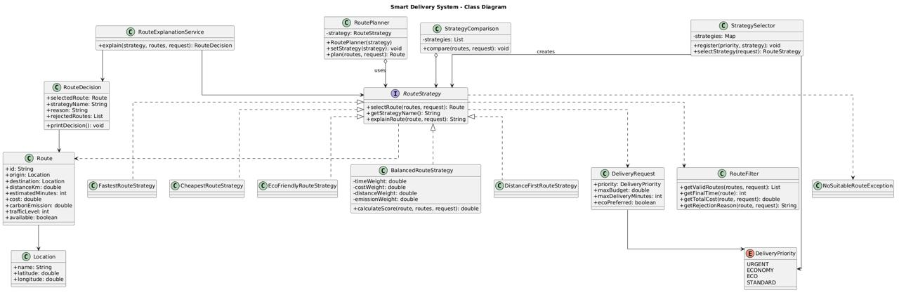
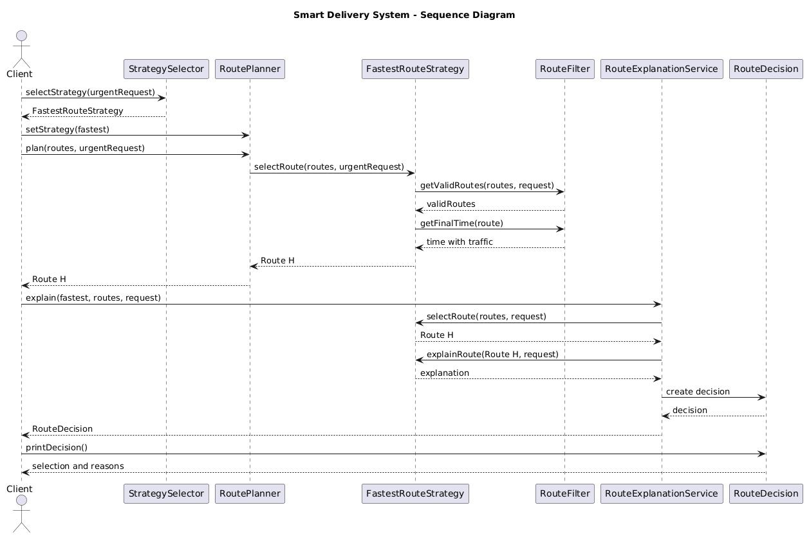

# Smart Delivery & Route Optimization Engine

**Assignment 5 – Strategy Pattern**  
**Student:** Sayazhan Kanat  
**Course:** Software Design Patterns  
**Java:** 21 | **Build:** Maven | **Tests:** JUnit 5

## Project Description

This project is a delivery route optimization system using the Strategy Design Pattern. It selects routes based on delivery time, cost, distance and CO2 emissions.

The system contains 8 candidate routes and 5 selection strategies.

## Strategies

| Strategy | Selection Criteria |
|---|---|
| FastestRouteStrategy | Minimum time with traffic |
| CheapestRouteStrategy | Minimum total cost |
| EcoFriendlyRouteStrategy | Minimum environmental score |
| BalancedRouteStrategy | Weighted score of four criteria |
| DistanceFirstRouteStrategy | Minimum distance |

### Formulas

**Fastest:** Final Time = Estimated Time + Traffic Level × 3

**Cheapest:** Total Cost = Base Cost + Distance × 50 + Priority Fee

Urgent deliveries have an additional fee of 500 KZT.

**Eco:** EcoScore = CO2 × 0.8 + Distance × 0.2

**Balanced:**

Score = Normalized Time × 0.4 + Normalized Cost × 0.3
+ Normalized Distance × 0.1 + Normalized Emission × 0.2

The values are normalized using the maximum value among valid routes. Weights are configurable and must sum to 1.0.

## Architecture

- `RouteStrategy` – common interface for algorithms.
- `RoutePlanner` – Context that uses a strategy.
- `StrategySelector` – automatically chooses a strategy.
- `RouteFilter` – checks budget, deadline and availability.
- `RouteDecision` – stores the result and explanation.
- `StrategyComparison` – compares all strategies.

### UML Class Diagram



### UML Sequence Diagram



## Runtime Switching

The same RoutePlanner can use different strategies:

```java
planner.setStrategy(new FastestRouteStrategy());
planner.plan(routes, request);

planner.setStrategy(new CheapestRouteStrategy());
planner.plan(routes, request);
```

Automatic selection uses delivery priority:

| Priority | Strategy |
|---|---|
| URGENT | Fastest |
| ECONOMY | Cheapest |
| ECO | EcoFriendly |
| STANDARD | Balanced |

## Constraints and Error Handling

Routes are filtered by availability, final delivery cost and deadline.

The application handles empty route lists, impossible budgets, short deadlines, invalid weights and negative route values.

If no suitable route exists, `NoSuitableRouteException` is thrown.

## Example Results

For an URGENT request with a 6000 KZT budget and 40-minute deadline:

| Strategy | Selected Route |
|---|---|
| Fastest | Route H |
| Cheapest | Route E |
| EcoFriendly | Route H |
| Balanced | Route H |
| DistanceFirst | Route F |

Each strategy also provides an explanation of its decision and rejected routes.


## Additional Feature - Interactive Menu

I also added an interactive console menu as an extra feature.

Users can view routes, choose a strategy, compare results and enter their own budget, deadline and delivery priority.

The menu uses the existing RoutePlanner and StrategySelector classes.


## Testing

JUnit 5 was used to test strategies, switching, selection, constraints and invalid inputs.

```text
Tests run: 20
Failures: 0
Errors: 0
Skipped: 0
BUILD SUCCESS
```

Run tests with:

```bash
mvn clean test
```

## Defense Questions

**1. What problem does Strategy solve?**  
It separates route selection algorithms and allows switching between them.

**2. Where is the Context?**  
`RoutePlanner` is the Context.

**3. Where is the Strategy interface?**  
`RouteStrategy.java`.

**4. What are the Concrete Strategies?**  
Fastest, Cheapest, EcoFriendly, Balanced and DistanceFirst.

**5. Where is runtime switching demonstrated?**  
In `Main.java` using `setStrategy()`.

**6. Why Strategy instead of if/else?**  
Each algorithm has its own class, making the code easier to maintain and extend.

**7. How can a new Strategy be added?**  
Create a class implementing `RouteStrategy`. RoutePlanner does not need changes.

**8. Strategy vs Bridge?**  
Strategy switches algorithms. Bridge separates abstraction from implementation. My previous Bridge assignment used notification types and message senders.

**9. Which SOLID principles are used?**  
SRP separates responsibilities, OCP supports new strategies, and DIP makes RoutePlanner depend on an interface.

**10. What limitations exist?**  
The project uses predefined routes instead of real GPS and traffic data. The simplified eco formula and normalization can also be improved.

## Conclusion

I implemented five interchangeable route selection strategies, automatic selection, explanations, constraints and comparison mode. This assignment helped me understand the Strategy Pattern and practice Java, Maven, Git and JUnit.